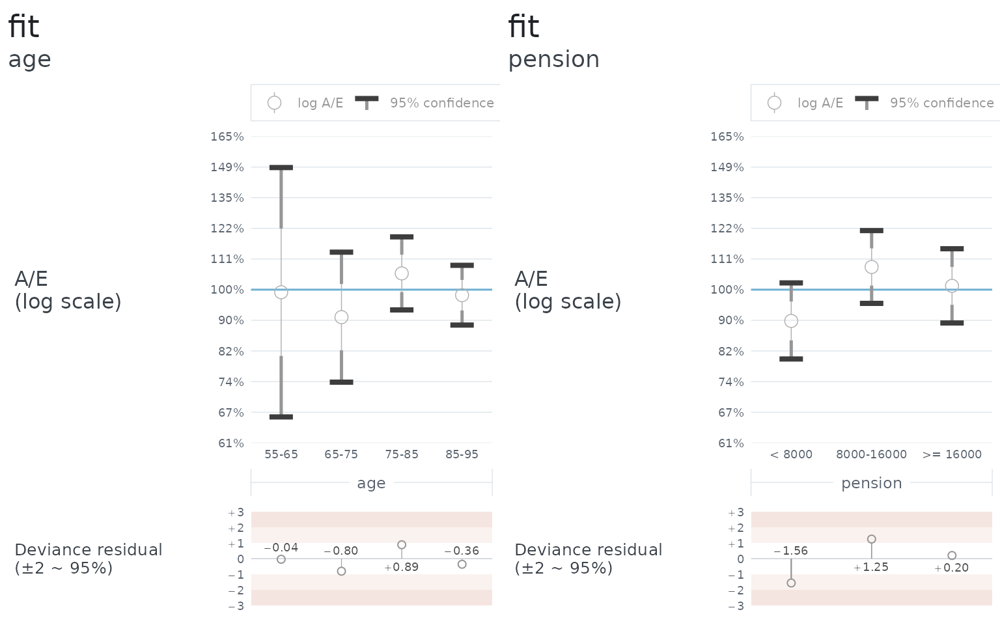

# Fit a model

``` r

library(logmu)
```

A mortality model in **logmu** is a reference mortality with a
proportional adjustment on top:

\log\mu = \log\mu^\text{ref} + \sum_j \beta_j X_j

where the X_j are covariates you write as functions of the individual
and of time, and the \beta_j are what
[`fit()`](https://r-logmu.logmu.org/reference/fit.md) estimates, by
maximum weighted log-likelihood. The reasoning is in [Proportional
hazards](https://r-logmu.logmu.org/articles/B040-proportional-hazards.md);
this article is about running it.

## A portfolio whose truth is known

The trouble with real data is that you never learn whether the fit was
right. So this walkthrough uses data drawn from a mortality that is
written down first, by
[`simulate()`](https://r-logmu.logmu.org/reference/simulate.md), and
every result below can be checked against it.

The population is a data frame with a `birth` column and whatever else
the model will read. Here that is sex and a pension, plus a start date
for those who retire during the period.

``` r

set.seed(2025)
lives <- 4000

population <- data.frame(
  birth     = datey::datey(2015 - sample(55:89, lives, replace = TRUE)),
  sex       = sample(c("male", "female"), lives, replace = TRUE, prob = c(0.6, 0.4)),
  pension   = round(exp(rnorm(lives, log(12000), 0.7))),
  E2R_start = datey::datey(2015 + ifelse(runif(lives) < 0.25, runif(lives, 0, 3), 0))
)
```

The truth is a Gompertz curve, steeper in age than the standard one,
with men 40% heavier than women:

``` r

truth <- mortality(
  if (.i$sex == "male") {
    gompertz_mortality(log_mu_0 = -3.4, slope_x = 0.12, slope_t = 0)
  } else {
    gompertz_mortality(log_mu_0 = -3.8, slope_x = 0.12, slope_t = 0)
  }
)

portfolio <- simulate(truth, lives = population,
                      exp_start = datey::datey(2015), exp_end = datey::datey(2020))
portfolio
#> # Exp data: 4,000 × 6 (5 yr)
#> #   Start:  2015-01-01.0
#> #   End:    2020-01-01.0
#>           birth sex    pension       E2R_start      E2R_end E2R_died
#>         <datey> <chr>    <dbl>         <datey>      <datey> <lgl>   
#>  1 1948-01-01.0 female   31063    2015-01-01.0 2020-01-01.0 FALSE   
#>  2 1949-01-01.0 male     18096 2017-05-07.5731 2018-05-11.5 TRUE    
#>  3 1935-01-01.0 male     16960    2015-01-01.0 2020-01-01.0 FALSE   
#>  4 1960-01-01.0 male     13400    2015-01-01.0 2020-01-01.0 FALSE   
#>  5 1938-01-01.0 female   40107    2015-01-01.0 2020-01-01.0 FALSE   
#>  6 1951-01-01.0 male      1867    2015-01-01.0 2020-01-01.0 FALSE   
#>  7 1948-01-01.0 female    3169    2015-01-01.0 2020-01-01.0 FALSE   
#>  8 1949-01-01.0 male      6836    2015-01-01.0 2020-01-01.0 FALSE   
#>  9 1957-01-01.0 male     11170    2015-01-01.0 2020-01-01.0 FALSE   
#> 10 1934-01-01.0 male     24224 2015-08-25.7937 2020-01-01.0 FALSE   
#> # ℹ 3,990 more rows
```

Each life is followed from its start until it dies, or until the period
ends, and a death is recorded to the day. What comes back is an
`exp_data` shaped exactly like data you would load yourself.

## The model

A `model` is a reference mortality and a set of covariates, and nothing
else. The reference here is the standard Gompertz curve with its time
trend switched off, which is deliberately not the truth: the level, the
sex difference and the age slope are all left for the fit to find.

``` r

reference <- gompertz_mortality(slope_t = 0)

sex_age <- model(reference, covariates(
  male   = .i$sex == "male",
  female = .i$sex == "female",
  age    = .x - 75
))
```

Each covariate is a pronoun expression: `.i$sex` reads a column, `.x` is
age, `.t` would be calendar time. A comparison gives an indicator, 1 or
0, so `male` and `female` are two levels rather than one level plus a
difference, and `age` is centred so that its coefficient is a slope and
the levels are read at 75.

Writing the two sex indicators as
[`disjoint()`](https://r-logmu.logmu.org/reference/covariates.md)
instead of
[`covariates()`](https://r-logmu.logmu.org/reference/covariates.md)
tells the engine that no individual can be in both, which lets it leave
their cross-terms out of the information matrix. It makes no difference
to the answer and a large difference to the cost once there are many
groups.

## Fitting it

`overdispersion` has no default, because mortality data is always
overdispersed and by an amount the analyst has to own. Simulated data is
the one case where 1 is the truth.

``` r

f <- fit(portfolio, sex_age, overdispersion = 1)
f
#> <fit: 3 terms, 5 iterations, 5 walks of the data>
#>   include         all records
#>   weight          lives
#>   data            783 deaths, 16709 years of exposure
#>   test mortality  logmu default
#>                   Aw 783   Ew 515.53   Ew^2 515.53   Z 1
#>                   log A/E 0.41794 ± 0.044043 (1 sd) or ± 0.086322 (95%), at overdispersion 1
#>   overdispersion  1
#> 
#>        estimate std_error conf_95pc
#> male   0.433759  0.059011  0.115659
#> female 0.001018  0.074462  0.145944
#> age    0.022448  0.004797  0.009402
#> 
#> correlation
#>         male female
#> female  0.37       
#> age    -0.67  -0.56
#> 
#> L -2728.393   p 3   L_P -2731.393   k 3
```

Reading downwards: the header says what the fit was run over and what it
saw – deaths, exposure, and the crude A/E on `test_mortality`, which is
the yardstick the Z scale is measured on. With no weight, w^2 = w and Z
is exactly 1.

The coefficient table gives each estimate with two widths, and both are
named: `std_error` is one standard deviation, and `conf_95pc` is the 95%
half-width that the A/E charts draw, 1.96 times the first. Against the
truth: `male` should be -3.4 - (-3.8 + 0) = 0.4 at age 75 and `female`
should be 0, and `age` should be 0.12 - 0.10 = 0.02. Every one of them
is inside its `conf_95pc`.

The correlation matrix underneath is the covariance of the estimates
with the units taken out. The negative correlation between the levels
and the slope is the usual one: a higher level and a steeper slope
explain the same deaths, and the data cannot quite separate them. It is
why the coefficients should be read together and not one at a time.

The last line is the log-likelihood L, the penalty p and the penalised
log-likelihood L\_\text{P} = L - p that models are compared on. With no
weight p is exactly the number of terms, `k`. The reasoning for that is
in [Suddenly
AIC](https://r-logmu.logmu.org/articles/B050-suddenly-aic.md), and the
comparison itself is the [next
article](https://r-logmu.logmu.org/articles/A030-test-multiple-models.md).

[`summary()`](https://rdrr.io/r/base/summary.html) returns all of this
as an object, so `summary(f)$coefficients` and `summary(f)$correlation`
can be programmed against; [`coef()`](https://rdrr.io/r/stats/coef.html)
and [`vcov()`](https://rdrr.io/r/stats/vcov.html) give the estimates and
their covariance.

## Where the iteration starts, and why it rarely matters

Every fit starts at \beta = 0, which is the reference mortality itself.
The header’s “5 iterations, 5 walks of the data” is what that costs:
Newton-Raphson on a log-likelihood this well behaved converges in a
handful of steps. A step that would overshoot is halved until it does
not, and each halving is another walk of the data, so the two counts
differ when that has happened. Here it has not.

So the starting point tends not to matter, and
[`compare_models()`](https://r-logmu.logmu.org/reference/compare_models.md)
has no argument for it at all. When it does matter – a reference so far
from the data that the first steps are wasted, or a model on the edge of
what the data supports – the right move is not to hunt for a better
\beta but to move the reference: translate \log\mu^\text{ref} by a
weighted sum of the covariates so that \beta = 0 is where the data
already is. [`fit()`](https://r-logmu.logmu.org/reference/fit.md) keeps
a `start` argument as an escape hatch for the rare case where that is
not enough.

## The fitted model is a mortality

`f$mortality` is a `mortality` like any other, with the coefficients
folded in. It can go straight back into
[`aev()`](https://r-logmu.logmu.org/reference/aev.md), or be used as the
reference of a further model, which is how fitting is layered.

Against the data it was fitted to, an A/E on it comes out at 100% by
construction – the score equations are zero at the maximum – so the
useful question is how it does on subsets the fit did not see as such.
[`diagnose()`](https://r-logmu.logmu.org/reference/diagnose.md) asks
that for whatever breakdowns you name, reusing the fit’s own include,
weight and overdispersion, and crossing the data once for all of them:

``` r

d <- diagnose(portfolio, f,
              breakdown = list(age = ages(55, 95, by = 10),
                               pension = bands(.i$pension, thresholds = c(8000, 16000))))
d
#> <diagnosis: 1 candidate, 2 breakdowns>
#>   include         all records
#>   weight          lives
#>   overdispersion  1
#> 
#> ---- fit
#> 
#>        estimate std_error conf_95pc
#> male   0.433759  0.059011  0.115659
#> female 0.001018  0.074462  0.145944
#> age    0.022448  0.004797  0.009402
#> 
#> correlation
#>         male female
#> female  0.37       
#> age    -0.67  -0.56
#> 
#> A/E by age
#> <aev[4]>
#>   group  name   A         E         V       A/E   95% conf   dev resid
#> 1   age 55-65  23  23.19364  23.19364 0.9916510 0.40697113 -0.04026476
#> 2   age 65-75  78  85.32419  85.32419 0.9141604 0.21218369 -0.80467973
#> 3   age 75-85 285 270.26062 270.26062 1.0545377 0.11922208  0.88860804
#> 4   age 85-95 397 404.22164 404.22164 0.9821345 0.09748512 -0.36026899
#> 
#> A/E by pension
#> <aev[3]>
#>     group       name   A        E        V       A/E  95% conf  dev resid
#> 1 pension     < 8000 225 249.1816 249.1816 0.9029558 0.1241624 -1.5577255
#> 2 pension 8000-16000 293 272.0849 272.0849 1.0768699 0.1188217  1.2522234
#> 3 pension   >= 16000 265 261.7336 261.7336 1.0124798 0.1211486  0.2014829
```

``` r

plot(d)
```



The age bands sit on 100% within their intervals, which is what a
correct age slope looks like. The pension bands do too, and should: the
truth has no pension effect, so a model without one is right not to find
it. A fit to real data would be judged the same way, on the breakdowns
that matter to the liabilities.

## Weighting by amounts

Weight the log-likelihood by pension and the fit follows the money:

``` r

fit(portfolio, sex_age, weight = .i$pension, overdispersion = 1)
#> <fit: 3 terms, 5 iterations, 5 walks of the data>
#>   include         all records
#>   weight          .i$pension
#>   data            783 deaths, 16709 years of exposure
#>   test mortality  logmu default
#>                   Aw 12120164   Ew 7866351   Ew^2 2.0255e+11   Z 25748
#>                   log A/E 0.43228 ± 0.057212 (1 sd) or ± 0.11213 (95%), at overdispersion 1
#>   overdispersion  1
#> 
#>        estimate std_error conf_95pc
#> male    0.42478  0.076321   0.14959
#> female  0.05936  0.093927   0.18409
#> age     0.02294  0.006162   0.01208
#> 
#> correlation
#>         male female
#> female  0.37       
#> age    -0.67  -0.55
#> 
#> L -1639.101   p 2.995653   L_P -1642.097   k 3
```

Two things change. The header now measures Z = \mathrm{E}w^2/\mathrm{E}w
on `test_mortality`, because it is no longer 1, and the penalty is no
longer a count. The estimates are close to the unweighted ones here
because the truth has no pension effect; on a real portfolio where
mortality varies with amount, the two fits would differ, and the
weighted one is the one the liabilities care about.

What to do with several candidate models is the [next
article](https://r-logmu.logmu.org/articles/A030-test-multiple-models.md).
